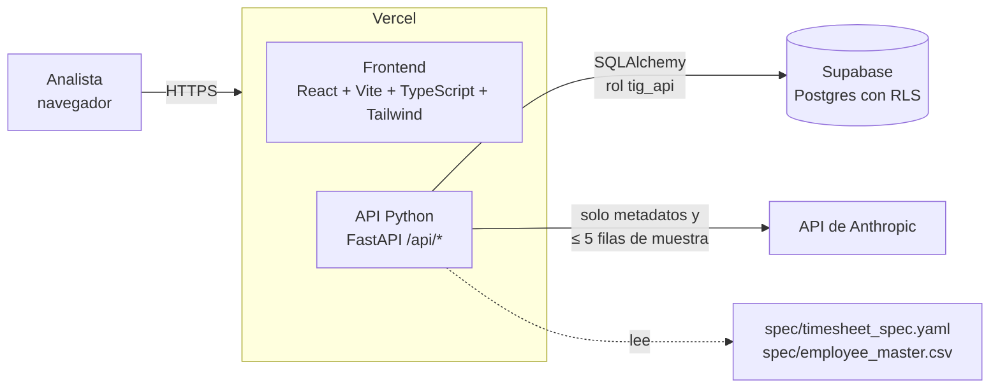

# Timesheet Intake Gate

Validación de las hojas de tiempo mensuales **antes** de cargarlas a nómina. Detecta defectos, asigna una disposición a cada archivo y genera un reporte de calidad. La IA ayuda a interpretar; el código toma las decisiones; un humano aprueba lo consecuente.

> Proyecto del bootcamp de IA aplicada: *Build the control, not just the chatbot*.

## El problema

Cada mes, cuatro sedes (SCL, VAP, CCP y ANF) envían un archivo con las horas trabajadas que alimenta la nómina. Hoy un analista los revisa a mano. Si un archivo falta, cambia de estructura o trae datos inválidos, la nómina falla o, peor, sale incompleta sin que nadie lo note.

Esta aplicación inspecciona el lote mensual **antes de la carga**:

1. Detecta 12 tipos de defecto (D01–D12), cada uno con su evidencia: valor encontrado frente a valor esperado, filas afectadas y regla aplicada.
2. Asigna a cada archivo una disposición: `LOAD`, `LOAD_WITH_WARNINGS`, `QUARANTINE` o `BLOCK`.
3. Deja que el analista acepte o rechace mapeos de columnas y fije excepciones con justificación. Todo queda en una auditoría que no se puede editar.
4. Exporta un reporte de calidad en HTML, imprimible a PDF.

## Arquitectura



El backend tiene capas que no se mezclan:

| Capa | Carpeta | Regla |
|---|---|---|
| **Motor determinístico** | `backend/app/engine/` | Funciones puras: archivos + contrato → hallazgos + disposición. No importa nada de `ai/` ni de `db/` (un test lo verifica). |
| **Asistencia de IA** | `backend/app/ai/` | Recibe hallazgos ya calculados y devuelve texto o sugerencias. Nunca escribe hallazgos ni disposiciones. |
| **Servicios** | `backend/app/services/` | Orquestan el motor, la base de datos y la auditoría. |
| **API** | `backend/app/routes/` | Endpoints delgados. |

Las reglas, severidades, umbrales y la lógica de disposición viven en [spec/timesheet_spec.yaml](spec/timesheet_spec.yaml), no en el código ni en un prompt.

## Frontera IA vs. código

| Decide el código | Propone la IA | Aprueba el humano |
|---|---|---|
| Qué es un defecto, su severidad y sus filas | Equivalencia entre una columna desconocida y una requerida | Aceptar o rechazar cada mapeo |
| La disposición de cada archivo | Causa probable del problema | Un override de disposición, con justificación |
| Si el lote queda apto para carga | Borrador del mensaje a la sede | Enviar el mensaje (la app no envía nada) |

## Cómo se controla la incertidumbre

- **Nada de la IA se aplica solo.** Una sugerencia de mapeo solo se usa si el analista la acepta; entonces el archivo se revalida y la disposición se recalcula con las reglas.
- **La IA solo ve metadatos y muestras pequeñas:** encabezados, hallazgos y como máximo 5 filas o 5 valores por columna. Nunca el archivo completo (un test lo comprueba).
- **Toda afirmación debe citar hallazgos existentes.** Lo que cita códigos inexistentes se descarta; lo que no cita ninguno se muestra como «Sin respaldo en hallazgos».
- **Confianza menor a 0,7 → «Requiere revisión humana».**
- **Cada respuesta se valida con pydantic.** Si no cumple el formato, la sección muestra «No disponible».
- **Sin IA, la app funciona completa.** Sin clave, con la API caída o con una respuesta inválida, los hallazgos, disposiciones, revisión, overrides, auditoría y reporte salen igual.
- **Los overrides relajados quedan marcados** como «Override permisivo», y si la disposición calculada cambia después, se avisa.
- **La auditoría y los overrides son de solo inserción**, también a nivel de base de datos.

## Resultados de la evaluación

Se mide el motor sobre 6 lotes sintéticos (1 limpio y 5 con defectos sembrados) contra su `ground_truth.json`. Los lotes se generan con una semilla fija: el resultado se puede repetir.

| Métrica | Resultado |
|---|---:|
| Detección global | **100 %** (66 de 66 defectos sembrados) |
| Falsos positivos | 0 % |
| Exactitud de disposición | 100 % (0 incorrectas de 26 archivos) |
| Candidatas determinísticas de columnas renombradas (D05) | 100 % |
| Mapeos sugeridos por la IA | se mide con `python scripts/evaluate.py --with-ai` |
| Tiempo por lote (motor) | entre 30 y 80 ms |

Cada uno de los 12 códigos aparece en al menos 2 lotes, e incluye el borde exacto del umbral (5 de 250 filas = 2 %, que **no** es cuarentena). La tabla completa está en [reports/evaluation.md](reports/evaluation.md) y se ve en la pantalla **Métricas**.

## Cómo levantarlo

Requisitos: Node 20+, Python 3.12, la CLI de Vercel (`npm i -g vercel`) y un proyecto de Supabase.

```bash
npm install
python -m venv .venv && .venv/Scripts/pip install -r requirements-dev.txt   # en Linux/Mac: .venv/bin/pip
vercel link          # una sola vez
vercel dev           # sirve el frontend y la API juntos
```

**Un solo comando para levantar todo: `vercel dev`.**

Variables de entorno (en `.env.local` y en Vercel → Settings → Environment Variables):

| Variable | Uso |
|---|---|
| `DATABASE_URL` | Conexión a Supabase por el pooler (puerto 6543) con el rol `tig_api`. |
| `ANTHROPIC_API_KEY` | Opcional. Sin ella, la IA queda «No disponible». |
| `LLM_MODEL` | Modelo de Anthropic para la IA (por ejemplo `claude-sonnet-5-5`). |

Base de datos: ejecutar en Supabase → SQL Editor los archivos de [supabase/migrations/](supabase/migrations/) en orden, y asignar la contraseña al rol `tig_api`. Todas las tablas tienen RLS activo y no hay acceso para `anon` ni `authenticated`.

### Pruebas y evaluación

```bash
.venv/Scripts/python -m pytest                      # 70+ tests, sin red, sin clave y sin Supabase
python scripts/generate_dataset.py                  # regenera los lotes sintéticos (semilla 42)
python scripts/evaluate.py                          # tabla en markdown + reports/evaluation.json
python scripts/evaluate.py --with-ai                # además mide la precisión de la IA (necesita clave)
python scripts/smoke_db.py                          # prueba la API contra la base real, sin dejar datos
```

`evaluate.py` termina con error si la detección global es menor a 95 % o si hay una disposición incorrecta.

## Estructura

```
src/                  frontend (pages, components, services, hooks, lib, context)
api/index.py          entrada de la función Python en Vercel
backend/app/          engine, ai, services, routes, db, contract
backend/tests/        pytest
spec/                 contrato (YAML) y maestro de empleados
scripts/              generate_dataset.py, evaluate.py, smoke_db.py
datasets/             lotes sintéticos y su ground truth
supabase/migrations/  SQL numerado con tablas, RLS y rol
docs/                 requirements.md, design.md, tasks.md
```

## Limitaciones conocidas

- **Un empleado de otra sede no se detecta.** D12 comprueba que exista y esté activo en el maestro, no que pertenezca a la sede del archivo. Queda fuera del conjunto cerrado D01–D12.
- **Los datos de evaluación son sintéticos y los sembró el mismo equipo que escribió el motor.** Mide que el motor haga lo que se diseñó, no descubre malentendidos del enunciado. Con archivos reales aparecerían casos nuevos.
- **La precisión de la IA aún no se midió con el modelo real.** La medición está implementada y probada con una IA simulada; falta correrla con clave.
- **El total diario se calcula por fila** (`regular_hours + overtime_hours`), no por empleado y día.
- **Solo se lee la primera hoja de un `.xlsx`** y la numeración de filas sigue a Excel (encabezado = fila 1).
- **D02 y D03 detienen la validación del contenido** del archivo afectado.
- **Tamaño máximo de 4 MB por lote**, por el límite de Vercel (4,5 MB por request).
- **El tiempo de procesamiento se registra por lote**, no por archivo, porque el motor es puro y no lee el reloj.
- **Sin autenticación ni roles** (fuera de alcance). El nombre del analista se pide una vez y se guarda en el navegador; la URL pública se protege con *Deployment Protection* de Vercel y solo se usan datos sintéticos.
- **Las URL de preview de Vercel no se pueden consultar sin iniciar sesión**, por esa misma protección.

## Decisiones de diseño

Están registradas en [docs/design.md](docs/design.md) (sección 12). Las más importantes: el motor no usa pandas (`csv` + `openpyxl`, más liviano en Vercel); la IA usa salida estructurada con validación pydantic porque los modelos actuales rechazan el `tool_choice` forzado; y el frontend nunca habla directo con Supabase, solo con la API.
