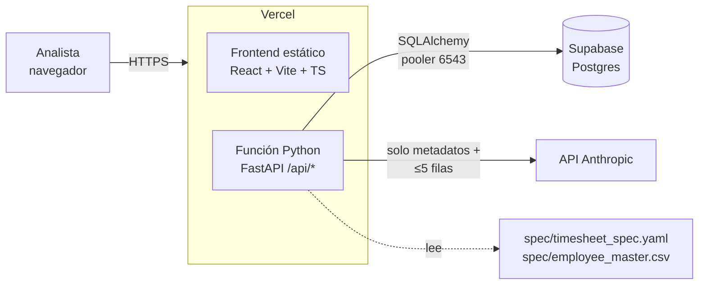

# Design — Timesheet Intake Gate

> Cómo se construye lo que pide `requirements.md`. Cada sección indica los requisitos que cubre.
> Si la implementación contradice este documento, se corrige primero el documento (CLAUDE.md §14).

## 1. Arquitectura



Dentro de la función Python hay tres capas que no se mezclan:

```
api/index.py            → punto de entrada para Vercel (expone la app FastAPI)
backend/app/
  engine/               → MOTOR DETERMINÍSTICO. Funciones puras: archivos + contrato → hallazgos + disposición.
                          No importa nada de ai/ ni de db/.
  ai/                   → ASISTENCIA IA. Recibe hallazgos ya calculados y devuelve texto/sugerencias.
                          Nunca escribe hallazgos ni disposiciones.
  services/             → orquestación: llama al motor, guarda en DB, registra auditoría, llama a la IA.
  db/                   → modelos SQLAlchemy y sesión.
  routes/               → endpoints FastAPI (delgados: validan input y llaman a services/).
  contract/             → carga y valida el YAML y el maestro (pydantic).
```

**Regla de frontera (R7.4):** `engine/` no puede importar `ai/`. Un test lo verifica leyendo los imports
(`test_engine_does_not_import_ai`). Así, aunque alguien quiera usar la IA para decidir, el código no compila esa dependencia.

## 2. Estructura del repositorio

```
/                         (raíz = proyecto Vercel)
  index.html, package.json, vite.config.ts, tailwind.config.js, tsconfig.json
  src/                    frontend (estructura de CLAUDE.md §4)
    components/ pages/ hooks/ lib/ services/ types/
  api/index.py            entrada de la función Python
  backend/app/...         código Python (ver §1)
  backend/tests/          pytest
  spec/                   timesheet_spec.yaml, employee_master.csv
  scripts/                generate_dataset.py, evaluate.py
  datasets/               lotes sintéticos generados (versionados, ver D-11)
  reports/                evaluation.md, evaluation.json
  supabase/migrations/    001_...sql
  requirements.txt        dependencias Python (las lee Vercel)
  vercel.json
  .env.local              nunca se versiona
```

## 3. Contrato (`spec/timesheet_spec.yaml`) — R1

Todo lo que es regla vive aquí; el código solo sabe interpretar este formato.

```yaml
version: 1
sites: [SCL, VAP, CCP, ANF]
# (?i:...) hace que solo la extensión ignore mayúsculas (R3.1)
file_name_pattern: '^TS_(?P<site>[A-Z]{3})_(?P<yyyymm>\d{6})\.(?i:csv|xlsx)$'
date_formats: ['%Y-%m-%d', '%d-%m-%Y', '%d/%m/%Y']   # además, fechas nativas de Excel

columns:
  employee_id:    { type: str, pattern: '^E\d{5}$' }
  employee_name:  { type: str }
  site:           { type: str }
  cost_center:    { type: str }
  work_date:      { type: date }
  shift_code:     { type: catalog, catalog: shift_code }
  regular_hours:  { type: decimal, min: 0, max: 12, d07_severity: BLOCKER }
  overtime_hours: { type: decimal, min: 0, max: 4,  d07_severity: BLOCKER }
  absence_code:   { type: catalog, catalog: absence_code, nullable: true }
  approved_by:    { type: str, approval: true }   # nulo → D12, no D07
  approval_date:  { type: date, approval: true }

catalogs:
  shift_code:   [DAY, NIGHT, SWING]
  absence_code: [VAC, SICK, PERM]

aliases:                      # usados por el puntaje D05 (R4.3)
  overtime_hours: [horas extra, hh extra, overtime, horas_extras]
  regular_hours:  [horas, horas normales, hh normales]
  cost_center:    [centro costo, centro de costo, cc]
  shift_code:     [turno, shift]
  work_date:      [fecha, fecha trabajo]
  # ...

thresholds:
  max_null_pct: 0.05              # nulos en columna no nullable sobre esto → BLOCKER (R5.3)
  max_daily_total: 14
  quarantine_error_row_pct: 0.02  # estrictamente mayor (R16.2)
  d05_min_score: 0.6
  ai_min_confidence: 0.7
  ai_timeout_s: 30
  max_upload_mb: 4

severities:                       # D07 se ajusta por columna con d07_severity
  D01: BLOCKER
  D02: ERROR
  D03: BLOCKER
  D04: BLOCKER
  D05: WARNING
  D06: WARNING
  D07: ERROR
  D08: ERROR
  D09: ERROR
  D10: ERROR
  D11: ERROR
  D12: ERROR
file_level_full_impact: [D02]     # cuentan como 100 % de filas afectadas

disposition_rules:                # se evalúan en orden, gana la primera (R7.1)
  - { id: RULE_BLOCK,      disposition: BLOCK,              when: { severity: BLOCKER, min_open: 1 } }
  - { id: RULE_QUARANTINE, disposition: QUARANTINE,         when: { severity: ERROR, row_pct_gt: quarantine_error_row_pct } }
  - { id: RULE_WARN,       disposition: LOAD_WITH_WARNINGS, when: { any_open: true } }
  - { id: RULE_LOAD,       disposition: LOAD,               when: { always: true } }

code_descriptions:                # texto en español para la UI (R6.2)
  D01: Archivo esperado faltante
  # ... D02–D12

rule_texts:                       # "regla aplicada" de cada hallazgo (R6.1)
  D10.regular_range: regular_hours debe estar entre 0 y 12
  D10.overtime_range: overtime_hours debe estar entre 0 y 4
  D10.daily_total: regular_hours + overtime_hours debe ser ≤ 14
  D12.unknown_employee: employee_id debe existir en el maestro
  D12.inactive_employee: el empleado debe estar activo en el maestro
  D12.missing_approval: la fila debe tener approved_by y approval_date
  # ...
```

- Se valida con un modelo pydantic `Contract`. Si falla, la app no arranca y el error indica el campo (R1.3).
- El mini-lenguaje `when` tiene 4 condiciones (`min_open`, `row_pct_gt`, `any_open`, `always`). No se agregan más
  si no hacen falta.
- **Hash del contrato:** `sha256(yaml_bytes + master_bytes)`. Al crear un lote se guardan el YAML, el maestro y el
  hash en la fila del lote (R1.5).

## 4. Motor determinístico — R2 a R7

### 4.1 Interfaz

```python
def validate_batch(period: str, files: list[InputFile], contract: Contract,
                   master: Master, mappings: dict[str, dict[str, str]] = {}) -> BatchResult
def validate_file(file: InputFile, period: str, contract, master, mapping: dict[str, str]) -> FileResult
def decide(findings: list[Finding], row_count: int, contract) -> Disposition
```

Son funciones puras: no tocan la base de datos, la red ni el reloj. El tiempo lo mide `services/` alrededor
de la llamada. Esto permite que `evaluate.py` y los tests usen el motor directamente (R7.6).

### 4.2 Flujo por lote

1. **Ingesta** (R2.3–R2.5): se descomprimen los `.zip` en memoria (`zipfile`) y se ignoran `__MACOSX`, los
   archivos ocultos y las carpetas. CSV: se prueba `utf-8-sig` y, si falla, `latin-1`. El separador se
   detecta con `csv.Sniffer` entre `,` y `;`. XLSX: `pandas.read_excel(engine="openpyxl")` sobre la primera hoja.
   **Todo se lee como texto** (`dtype=str`, `keep_default_na=False`). Las celdas vacías o con solo espacios
   cuentan como nulo. Las fechas nativas de Excel se pasan a `YYYY-MM-DD` antes de validar.
2. **Nombres** (D02, D03, D01): se ordenan los archivos alfabéticamente, se aplica la regex y se asigna cada
   archivo a su sede (R3.1–R3.5).
3. **Estructura** (D04–D06): se normalizan los encabezados y se calcula el puntaje D05 (§4.3). Los mapeos
   aceptados se aplican renombrando columnas antes de validar.
4. **Contenido** (D07–D12): son validaciones vectorizadas con pandas, en este orden. Primero D07 marca las
   celdas inválidas. Después, D08–D12 solo usan celdas válidas (R5.9).
5. **Disposición** (§4.4).

### 4.3 Puntaje D05 (R4.3, R4.4)

Para cada par (columna desconocida *u*, columna requerida faltante *r*):

```
norm(x)   = minúsculas, sin tildes, solo [a-z0-9]
alias     = 1.0 si norm(u) ∈ norm(aliases[r])
name_sim  = difflib.SequenceMatcher(norm(u), norm(r)).ratio()
value_fit = proporción de los primeros 50 valores no nulos de u que cumplen el tipo de r
score     = 1.0 si alias, si no 0.6·name_sim + 0.4·value_fit
```

La asignación es golosa (se toma el mejor par disponible en cada paso): primero el par de mayor puntaje,
y los empates se ordenan por nombre. Cada *r* se usa una sola vez. Si `score ≥ d05_min_score`, se registra
D05 con la candidata. En otro caso, se registra D06.

### 4.4 Disposición

- `row_pct` = cantidad de filas **distintas** afectadas por hallazgos abiertos ERROR ÷ filas del archivo.
  Si hay un código en `file_level_full_impact`, vale 1.0.
- Las sedes con D01 y los archivos D02 también reciben una disposición: D01 → BLOCK y D02 → QUARANTINE.
- El resultado es `Disposition(value, rule_id, explanation)`, por ejemplo
  `"3,4 % de filas con ERROR > 2 %"` (R7.2).

### 4.5 Hallazgos

```python
class Finding(BaseModel):
    ref: str            # "SCL-007": sede (o EXT1, EXT2… para D02) + correlativo; determinístico
    code: str           # D01..D12
    severity: Literal["BLOCKER", "ERROR", "WARNING"]
    column: str | None
    rule_id: str        # p. ej. "D10.daily_total"
    rule_text: str
    affected_count: int
    affected_rows: list[int]       # numeración Excel (encabezado = 1)
    sample_rows: list[dict]        # ≤ 5
    evidence: dict                 # {"found": ..., "expected": ...}
    status: Literal["open", "resolved_by_mapping"]
```

El orden de emisión es fijo: código, después columna, después primera fila. El correlativo `ref` es
reproducible para los mismos datos (R7.6). Cuando un archivo se revalida, sus hallazgos se reemplazan
completos.

## 5. Base de datos (Supabase Postgres) — R10, R17.8, R17.9

Una migración, `supabase/migrations/001_create_core_tables.sql`. Todas las tablas tienen `id uuid` y
`created_at timestamptz`.

| Tabla | Columnas principales | Notas |
|---|---|---|
| `batches` | `period`, `analyst_name`, `contract_yaml`, `master_csv`, `contract_hash`, `processing_ms`, `ready_for_load` | Inmutable salvo `ready_for_load` |
| `batch_files` | `batch_id`, `kind` (`site_file`/`unexpected`/`missing`), `filename`, `site`, `content bytea`, `row_count`, `applied_mapping jsonb`, `computed_disposition`, `disposition_rule`, `disposition_explanation`, `processing_ms` | Una fila por archivo y por sede faltante |
| `findings` | `file_id`, `ref`, `code`, `severity`, `column_name`, `rule_id`, `rule_text`, `affected_count`, `affected_rows jsonb`, `sample_rows jsonb`, `evidence jsonb`, `status` | Se reemplazan al revalidar |
| `mapping_reviews` | `file_id`, `source_column`, `candidate_column`, `candidate_score`, `status` (`pending`/`accepted`/`rejected`), `chosen_column`, `decided_by`, `decided_at` | Una por columna D05/D06 |
| `overrides` | `file_id`, `disposition` (null = retiro), `justification`, `actor` | Solo inserción. Vale la última fila del archivo |
| `ai_results` | `file_id`, `kind` (`mapping`/`cause`/`remediation`), `status`, `model`, `latency_ms`, `payload jsonb`, `reason` | Vale el último resultado por (archivo, tipo) |
| `audit_log` | `batch_id`, `actor`, `action`, `entity_type`, `entity_id`, `before jsonb`, `after jsonb`, `justification` | Solo inserción (R10.2) |

**Seguridad (RLS):**
- RLS está activado en todas las tablas y no hay políticas para `anon` ni `authenticated`. Además se ejecuta
  `revoke all ... from anon, authenticated`. Así, la API pública de Supabase no expone ningún dato.
- El backend se conecta con un rol propio, `tig_api`, que se crea en la migración **sin contraseña**. El
  usuario le asigna la contraseña a mano en el SQL Editor, y esa contraseña vive solo en `DATABASE_URL`.
  Las políticas son `to tig_api using (true)`.
- `audit_log` y `overrides` reciben solo `select, insert` para `tig_api`. Un trigger además rechaza
  `UPDATE`/`DELETE` para cualquier rol (defensa en profundidad).
- Los archivos subidos se guardan en `bytea` y no en Supabase Storage (D-04).

**Conexión desde Vercel:** se usa el pooler de Supabase en modo transacción (puerto 6543), con
`psycopg[binary]`, `NullPool` y `prepare_threshold=None`. Una función serverless no puede mantener
conexiones abiertas entre requests.

**Tests:** el mismo modelo SQLAlchemy sobre SQLite en memoria (`Uuid` y `JSON` portables). El SQL de la
migración y los modelos se mantienen a mano. Un test compara los nombres de tablas y columnas de ambos
(`test_migration_matches_models`).

## 6. API (FastAPI, prefijo `/api`) — R2, R8–R13

Los errores siempre tienen la forma `{"error": {"code": "...", "message": "<en español>"}}`, con el código
HTTP correspondiente. No se muestran trazas (R12.2). Las acciones humanas incluyen `actor` en el body (R10.3).

| Método | Ruta | Uso |
|---|---|---|
| GET | `/api/health` | `{ status, ai_available, contract_hash }` |
| GET | `/api/contract` | Sedes, descripciones de códigos y columnas requeridas, para la UI |
| POST | `/api/batches` | multipart: `period`, `actor`, `files[]` → 201 `BatchSummary` |
| GET | `/api/batches` | Historial (R13.8) |
| GET | `/api/batches/{id}` | `BatchSummary`: entradas con disposiciones, totales por severidad, tiempos, `ready_for_load` |
| GET | `/api/files/{file_id}` | `FileDetail`: hallazgos, disposición calculada y final, mapeos, overrides, resultados IA |
| POST | `/api/files/{file_id}/ai/{kind}` | `kind ∈ mapping, cause, remediation` → `AiResult`. Un request por tipo (R17.4) |
| GET | `/api/batches/{id}/review` | Mapeos pendientes y entradas que se pueden cambiar con override |
| POST | `/api/mappings/{id}/accept` | `{ actor, target_column }` → revalida → `FileDetail` |
| POST | `/api/mappings/{id}/reject` | `{ actor }` |
| POST | `/api/files/{file_id}/override` | `{ actor, disposition, justification ≥ 20 }` |
| POST | `/api/files/{file_id}/override/withdraw` | `{ actor, justification ≥ 20 }` |
| GET | `/api/batches/{id}/audit` | Log del lote |
| GET | `/api/batches/{id}/report` | `text/html` descargable (R13.6) |
| GET | `/api/metrics` | Contenido de `reports/evaluation.json` o 404 con instrucciones (R13.7) |

Los tipos de respuesta se definen con pydantic en el backend y se reflejan a mano en `src/types/api.ts`.

**Revalidación al aceptar un mapeo (R8.3):** se carga `content` y la copia del contrato del lote. Luego se
llama a `validate_file` con el mapeo acumulado y se reemplazan los hallazgos. Después se recalcula la
disposición y `ready_for_load`. También se marcan como obsoletos los `ai_results` del archivo, porque
citan refs que ya no existen. Al final se registra la auditoría con el antes y el después (disposición y
conteos por severidad). Todo ocurre en una sola transacción.

## 7. Asistencia IA — R11, R12

### 7.1 Llamada

- Usa el SDK oficial `anthropic`, con el modelo `os.environ["LLM_MODEL"]`, el timeout `ai_timeout_s` y sin
  reintentos.
- Para obtener JSON estructurado se usa **salida estructurada** (`output_config.format` con un esquema JSON). Los
  modelos actuales rechazan `tool_choice` forzado. La respuesta se valida con `Model.model_validate(...)`. Si falla, el estado queda `invalido` (R11.4).
  *(Los detalles del SDK se verifican contra la versión instalada al implementar.)*
- Si no hay `ANTHROPIC_API_KEY`, la función devuelve `no_disponible` sin hacer la llamada (R12.1).

### 7.2 Payload (R11.3)

`build_payload(file, findings)` arma un objeto con estos campos: nombre del archivo, sede, período,
encabezados, columnas requeridas faltantes, hallazgos abiertos (`ref, code, severity, column, evidence,
affected_count`) y `sample` con **5 filas como máximo**. Para mapeos, en lugar de filas se envían hasta 5
valores por columna desconocida. Un test verifica el límite.

### 7.3 Esquemas de salida

```python
class MappingSuggestion(BaseModel):
    source_column: str
    target_column: str | None      # None = "ninguna"
    confidence: float = Field(ge=0, le=1)
    justification: str

class Statement(BaseModel):
    text: str
    finding_refs: list[str]        # vacío = la IA declara que no tiene respaldo
    confidence: float = Field(ge=0, le=1)

class CauseAnalysis(BaseModel):    statements: list[Statement]
class RemediationDraft(BaseModel): subject: str; body: str; finding_refs: list[str]; confidence: float
```

### 7.4 Guardas (código, después de validar el esquema)

1. Las afirmaciones que citan refs inexistentes **se descartan** (R11.5).
2. Las afirmaciones con `finding_refs` vacío se muestran con la etiqueta "Sin respaldo en hallazgos".
3. Si `confidence < ai_min_confidence`, se marca `needs_review = true` → "Requiere revisión humana" (R11.6).
4. Una sugerencia de mapeo con destino `None` o que no es una columna requerida faltante **se descarta** (R11.7).
5. El resultado se guarda en `ai_results` y **nunca** se pasa al motor (R7.4).

### 7.5 Frontera IA vs. código (para el README)

| Decide el código | Propone la IA | Aprueba el humano |
|---|---|---|
| Qué es un defecto, su severidad y sus filas | Equivalencia de columnas (con confianza) | Aceptar o rechazar cada mapeo |
| La disposición de cada archivo | Causa probable del problema | Override de disposición con justificación |
| Si el lote está apto para carga | Borrador del mensaje a la sede | Enviar (o no) el mensaje, fuera de la app |

## 8. Frontend — R13

- Rutas (`react-router-dom`, definidas en `App.tsx`):
  `/` Nuevo lote · `/lotes` Historial · `/lotes/:id` Resumen · `/lotes/:id/archivos/:fileId` Detalle ·
  `/lotes/:id/revision` Cola de revisión · `/lotes/:id/auditoria` Auditoría · `/metricas` Métricas.
  El reporte se descarga desde el Resumen.
- `src/services/api.ts` es el único lugar que llama a `fetch`. Cada función devuelve `{ data, error }`
  (CLAUDE.md §6). Los componentes nunca llaman a `fetch` directamente.
- `AnalystContext` reemplaza al `AuthContext`: pide el nombre del analista una vez, lo guarda en
  `localStorage` y lo adjunta a cada acción (R10.3). No hay `ProtectedRoute` porque no hay autenticación
  (fuera de alcance).
- El Detalle pide las 3 secciones de IA en paralelo después de mostrar los hallazgos. Mientras esperan,
  muestran "Generando…" (R11.2).
- `useDocumentTitle(title)` pone el título de cada pestaña (R13.11).

## 9. Sistema de diseño (propuesta para aprobar — CLAUDE.md §5.1)

**Concepto de layout:** un acta de inspección. Una barra superior con el período y los pasos del lote, y
debajo un documento que se lee de arriba a abajo: veredicto → sedes → hallazgos.

**Paleta**

| Nombre | Hex | Función |
|---|---|---|
| Papel acta | `#F3F5F4` | Fondo general (gris verdoso frío, no crema) |
| Superficie | `#FFFFFF` | Tablas y paneles |
| Tinta | `#17212B` | Texto principal (≈ 15:1 sobre el fondo) |
| Grafito | `#4B5967` | Texto secundario (≈ 6,9:1, AA) |
| Línea | `#D3DADF` | Bordes y separadores |
| Azul timbre | `#1D4ED8` | Acento: acciones primarias y foco |

**Colores semánticos de disposición** (siempre acompañados de texto e ícono): `LOAD` `#15803D`,
`LOAD_WITH_WARNINGS` `#A16207`, `QUARANTINE` `#C2410C`, `BLOCK` `#B91C1C`. Todos cumplen AA como texto
sobre blanco.

**Tipografía:** **Archivo** (display, 600–800) para títulos, códigos de sede y cifras grandes, e
**IBM Plex Sans** (lectura) para el cuerpo y las tablas, con `tabular-nums` para las horas y los
conteos. Las dos se cargan desde Google Fonts. Escala fija: 14 · 16 · 20 · 28 · 40 · 64 px.

**Elemento firma — "la cinta de filas":** cada sede tiene una franja horizontal delgada que representa
todas sus filas, de la primera a la última. Cada segmento toma el color de la severidad más alta de esa
fila, y los segmentos vacíos van en gris claro. Así, el analista ve de un vistazo si los problemas están
concentrados (una exportación rota) o dispersos (errores de digitación). Al hacer clic en un segmento,
se abre el detalle filtrado por esas filas. Es el único momento con movimiento: la cinta se llena de
izquierda a derecha al cargar (desactivado con `prefers-reduced-motion`).

**Cómo se ven las sedes:** no se usa una grilla de tarjetas genéricas. Cada sede es un renglón del acta:
código grande en Archivo, sello de disposición, cinta de filas y conteos por severidad.

## 10. Dataset sintético y evaluación — R14, R15

- **Período de los lotes:** 2026-09. La seed por defecto es 42 (`random.Random(seed)`, sin `numpy.random`
  global). El XLSX se escribe con propiedades de documento fijas para que el resultado sea idéntico byte a
  byte (R14.1).
- **Datos base:** 60 empleados (15 por sede, 2 inactivos por sede). Solo los activos aparecen en los datos
  base, en días hábiles del período, con horas válidas (regular 8, overtime 0–2) y aprobación completa (R14.7).
- **Plan de siembra:** es una lista de operaciones (`rename_column`, `drop_column`, `add_column`,
  `set_cell`, `duplicate_row`, `drop_file`, `rename_file`, `add_file`). Cada operación agrega sus
  unidades esperadas al ground truth (R14.6). La disposición esperada la calcula el generador con su
  **propia** implementación simple de las reglas del YAML (no importa el motor).

| Lote | Escenario | Defectos sembrados |
|---|---|---|
| `batch_00_clean` | Mes normal | ninguno |
| `batch_01_old_template` | SCL exporta con plantilla antigua; VAP no envía | D05 (+D04), D06, D01, D08, D09 |
| `batch_02_wrong_files` | Archivo de agosto y un resumen suelto | D03, D02, D07 (horas), D10, D11 |
| `batch_03_approvals` | Aprobaciones incompletas y personal dado de baja | D12, D07 (fecha), D11 bajo umbral, D04 sin candidata |
| `batch_04_partial` | Dos sedes faltan y un nombre en minúsculas | D01 ×2, D02, D05, D10, D08 |
| `batch_05_mixed` | Mezcla para cubrir los bordes | D03, D06, D09, D12, D07, umbral exacto de 2 % |

Cada código D01–D12 aparece en al menos 2 lotes. El lote 05 incluye un archivo con exactamente 2 % de
filas con ERROR, que debe dar `LOAD_WITH_WARNINGS`.

- **Unidad de comparación (R15.2):** `(archivo|sede, código, columna|"", fila|0)`. Para D07–D12 se usa la
  fila; para D01–D06, `fila = 0`.
- `evaluate.py` usa el motor directamente (sin DB ni HTTP) y escribe `reports/evaluation.{md,json}`.
  Termina con `exit 1` si no cumple la definición de terminado (R15.4).

## 11. Despliegue y entorno local — R17

`vercel.json`:

```json
{
  "functions": {
    "api/index.py": {
      "maxDuration": 60,
      "excludeFiles": "{node_modules,src,public,datasets,scripts,backend/tests}/**"
    }
  },
  "rewrites": [
    { "source": "/api/(.*)", "destination": "/api/index" },
    { "source": "/(.*)", "destination": "/index.html" }
  ]
}
```

**Variables de entorno** (en `.env.local` y en Vercel para Production/Preview/Development):
`DATABASE_URL`, `ANTHROPIC_API_KEY` (opcional), `LLM_MODEL`.

**Comando único local:** `vercel dev` levanta el frontend y la API juntos. Requiere `npm i -g vercel` y
`vercel link` una vez (README). Los tests se corren con `pytest backend/tests`.

**Riesgo: tamaño de la función Python.** pandas, numpy y openpyxl suman unos 150 MB descomprimidos,
bajo el límite de Vercel. Se verifica **en la primera tarea**, desplegando un FastAPI que solo importa
pandas. **Plan B si no cabe:** reemplazar pandas por `csv` + `openpyxl` dentro de `engine/ingest.py`
(el resto del motor trabaja sobre listas de dicts a través de una interfaz `Table` interna), y avisarle
al usuario del cambio.

## 12. Registro de decisiones

| ID | Decisión | Por qué |
|---|---|---|
| D-01 | D05 se calcula de forma determinística; la IA solo sugiere | Las métricas de detección no dependen de la API |
| D-02 | Vercel + Supabase, sin Docker | Así lo pide CLAUDE.md y lo aprobó el usuario |
| D-03 | El frontend no usa supabase-js | Con RLS cerrado, la única entrada a los datos es la API |
| D-04 | Archivos en `bytea`, no en Storage | ≤ 4 MB por lote; una sola conexión y una sola transacción al revalidar |
| D-05 | Rol `tig_api` con políticas explícitas, sin service_role | Mínimo privilegio y auditoría inalterable por permisos |
| D-06 | IA por requests separados, sin tareas en segundo plano | Las funciones de Vercel terminan al responder |
| D-07 | Salida estructurada (`output_config.format` con esquema JSON) + validación pydantic para el JSON de la IA | Los modelos actuales rechazan `tool_choice` forzado (400); la salida estructurada garantiza JSON y pydantic valida rangos y contenido |
| D-08 | Overrides y auditoría solo de inserción | Historial completo sin columnas que se editen |
| D-09 | Hallazgos con `ref` legible (`SCL-007`) | La IA y el analista los citan sin UUIDs |
| D-10 | Al revalidar, los resultados IA del archivo quedan obsoletos | Citaban refs anteriores |
| D-11 | `datasets/` se versiona | El jurado puede reproducir sin correr el generador; la seed lo reconstruye igual |
| D-12 | Tipos TS escritos a mano, sin generador OpenAPI | Menos piezas para un MVP de 3 sábados |
| D-13 | El motor lee archivos con `csv` + `openpyxl` y valida sobre listas de dicts, sin pandas | Es el "plan B" del §11 aplicado de entrada: funcion más liviana en Vercel y menos riesgo; 2.000 filas por archivo no necesitan vectorización |
| D-14 | Si el contrato define D07 sin `d07_severity`, la severidad por defecto de la columna es ERROR | Solo las columnas de horas son BLOCKER en el contrato inicial |
